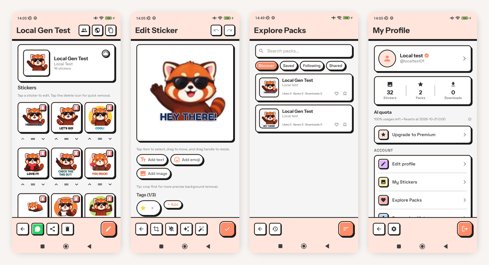
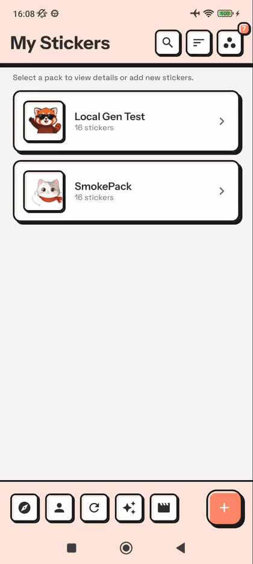
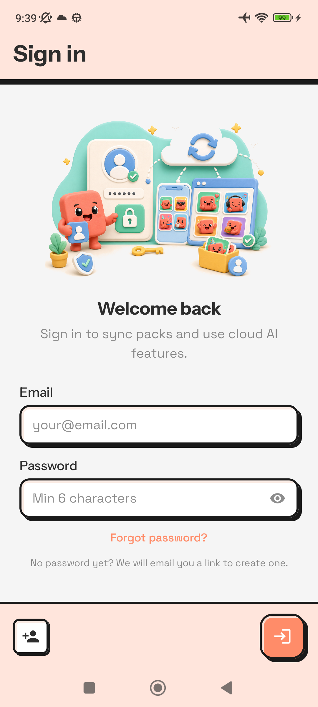
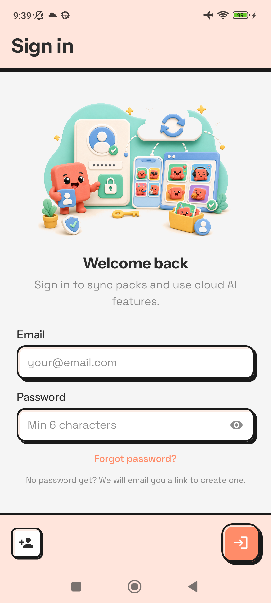
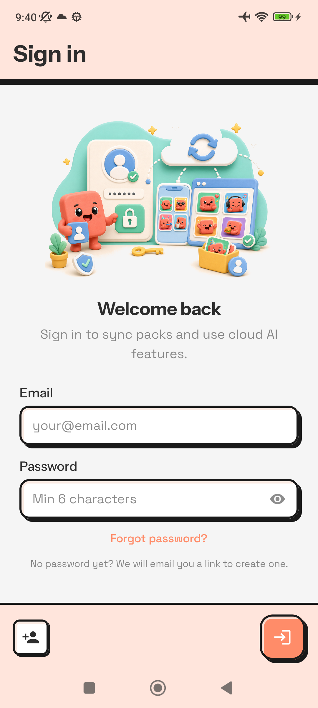
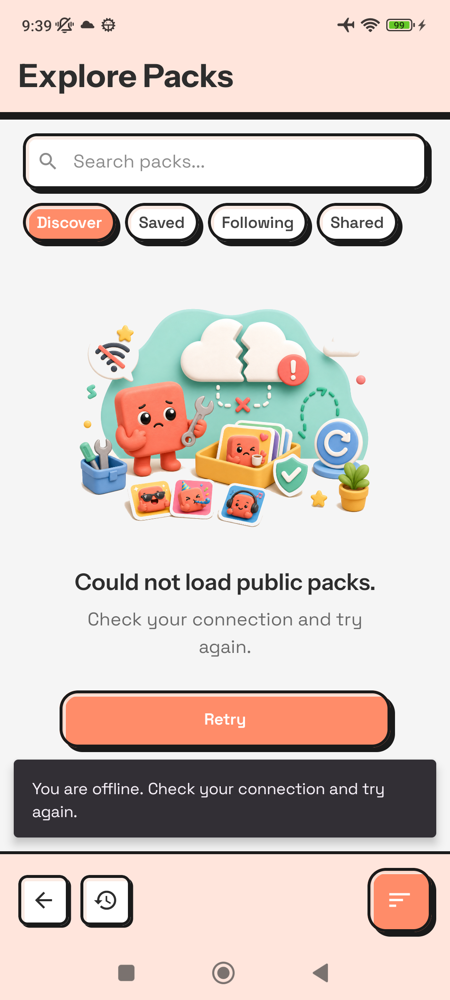
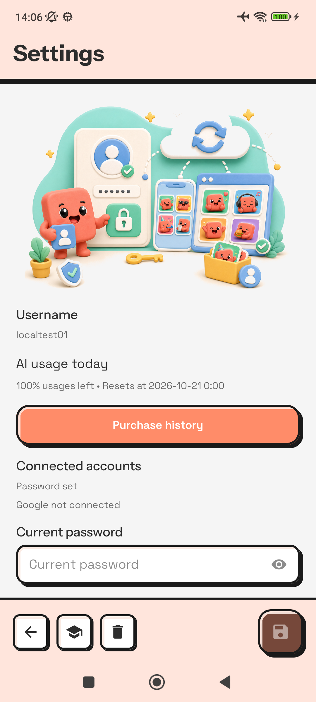
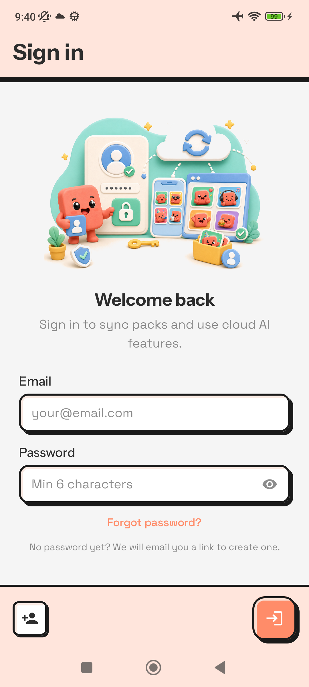
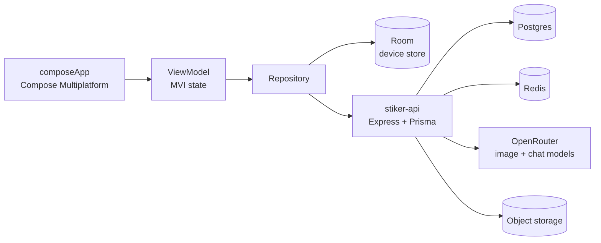

<p align="center">
  
</p>

<h1 align="center">Setiker</h1>

<p align="center">
  Turn a photo into a WhatsApp sticker pack.
</p>

<p align="center">
  <a href="LICENSE"></a>
  <a href="https://developer.android.com"></a>
  <a href="https://developer.apple.com/ios/"></a>
  
  
</p>

Setiker crops, de-backgrounds and decorates an image, then exports it as a WhatsApp sticker pack.
Packs live on the device first; sign in and they sync to the cloud, where AI can generate a whole
pack, clean up the background, or split a grid of stickers for you. One Kotlin codebase, Android and
iOS.

<p align="center">
  
</p>

<p align="center">
  
</p>

## What it does

| | |
| --- | --- |
|  **A pack, not a folder of images.** Every sticker has a tray icon, emoji tags and alt text, and the grid reorders with drag or arrows. |  **Edit in place.** Crop, remove the background, add text or emoji, drag the decoration around, and see the result on the sticker itself. |
|  **AI that keeps working in the background.** Generate a pack, improve a set, or split a grid. Jobs survive a restart, report their progress, and land in a drafts list you can review. |  **Publish and discover.** Share a pack with a link, browse what other people made, and save the ones you want. |
|  **Three screens, then you are in.** A short onboarding explains what a pack is, and the editor is right behind it. |  **Your quota, your account, your cloud.** The profile shows how much AI quota is left, what is signed in, and where the legal documents and account deletion live. |

## Quick start

You need **JDK 21**, the **Android SDK** (compile SDK 37), and the backend. The debug build talks to
`127.0.0.1:7845`, so the device reaches your machine over `adb reverse`.

```bash
git clone https://github.com/iqbalShafiq/setiker.git
cd setiker

# 1. the API (separate repo, see stiker-api/README.md)
git clone https://github.com/iqbalShafiq/stiker-api.git
cd stiker-api && docker compose up -d && npm run dev

# 2. let the device reach the API
adb reverse tcp:7845 tcp:7845

# 3. build and install
cd ../setiker
./gradlew :androidApp:installDebug
```

**iOS:** open `iosApp/iosApp.xcodeproj` in Xcode and run. The iOS build talks to
`http://13.251.98.162:8080`; point `ApiConfig.ios.kt` at your own server for local work.

## Configuration

| Setting | What it unlocks |
| --- | --- |
| `local.properties` → `GOOGLE_WEB_CLIENT_ID` | Google Sign-In on Android. Add the same client id to the API as `GOOGLE_CLIENT_IDS`. |
| `iosApp/iosApp/Info.plist` → `GIDClientID`, `GIDServerClientID` | Google Sign-In on iOS, plus the reversed client id in `CFBundleURLSchemes`. |
| `iosApp/iosApp/iosApp.entitlements` | Sign in with Apple (iOS only). |
| `composeApp/src/commonMain/kotlin/data/remote/ApiConfig.android.kt` | The base URL the app calls. Debug builds use `http://127.0.0.1:7845`. |
| `composeApp/src/commonMain/composeResources/font/` | The bundled text-decoration fonts. They ship with the app, so presets render offline. |

## Architecture



| Module | Responsibility |
| --- | --- |
| `composeApp/src/commonMain` | The whole app: screens, view models, data layer, design system. Shared by both platforms. |
| `composeApp/src/androidMain` | Android-only: Play Billing, Google Sign-In, an on-device u2net background remover (ONNX Runtime, int8), WorkManager jobs, Media3 video. |
| `composeApp/src/iosMain` | iOS-only: StoreKit 2, Apple Sign-In, and UIKit-based image and video processing. |
| `androidApp` | The Android application module. |
| `iosApp` | The Xcode project. |
| `docs/` | The design reference, the implementation plans, and the UI/UX and motion audit. |

Each feature follows the same shape: a `*State`, a `*Intent`, a `*Effect`, a `*ViewModel` and a
`*Screen`. The screen renders state and forwards intents; the view model owns the work.

### The design system

The UI is **neubrutalism**: thick black borders, hard offset shadows, flat colour, no gradients on
the chrome. It lives in `composeApp/src/commonMain/kotlin/presentation/theme/` and every screen
uses it.

Motion has one home too, `SetikerMotion`: durations, curves and springs. Press feedback is a firm
non-bouncy spring, because a button is pressed dozens of times a day and a wobble reads as
sloppiness. The one place a bounce is allowed is a celebration, such as the badge that pops when a
sticker is saved.

## Development

```bash
./gradlew :composeApp:testAndroidHostTest   # unit and view-model tests
./gradlew :composeApp:lint                   # Android lint
./gradlew :androidApp:installDebug           # build and install
```

The build treats **any compiler warning as an error** (`allWarningsAsErrors = true`), so a new
warning fails CI before it reaches a reviewer.

## Contributing

Issues and pull requests are welcome. Open a branch from `main`, keep the change focused, and say
what you ran.

The [UI/UX and motion audit](docs/plans/2026-10-19-ui-ux-motion-audit.md) is a good model for what
a change should come with: the finding, the evidence on a device, and the measurement after.

## License

Setiker is open source under the [MIT License](LICENSE).
